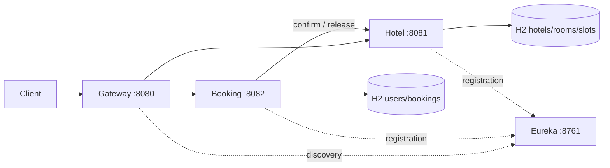

# Бронирование отелей

REST API для бронирования гостиничных номеров. Пользователь может зарегистрироваться, посмотреть свободные номера и создать или отменить бронь. Администратор управляет отелями, номерами и пользователями.

Стек: Java 17, Spring Boot 3.5.7, Spring Cloud 2025.0.0, Spring Data JPA, H2, Spring Security, JWT, Eureka и Gateway.

## Архитектура



## Запуск

Нужен JDK 17+ (проверено на JDK 17). JAVA_HOME должен указывать на каталог JDK, без /bin. Maven скачивается Wrapper автоматически; при первой сборке нужен интернет.

Windows: `./mvnw.cmd clean verify`. Linux/macOS: `sh mvnw clean verify`.

В четырёх терминалах, из корня проекта, в таком порядке:

```shell
java -jar discovery/target/discovery-1.0.0.jar
java -jar hotel/target/hotel-1.0.0.jar
java -jar booking/target/booking-1.0.0.jar
java -jar gateway/target/gateway-1.0.0.jar
```

Дождитесь регистрации сервисов в Eureka: http://localhost:8761 (при первом запуске до 90 секунд, включая обновление кешей клиентов). Либо после сборки `docker compose up --build`. Docker публикует только Gateway и Eureka. Swagger доступен при локальном запуске: http://localhost:8081/swagger-ui/index.html и http://localhost:8082/swagger-ui/index.html. Для защищённых запросов используйте заголовок Authorization: Bearer <token>.

JWT действует час. Демо-администратор: admin / Admin12345! (изменяется DEMO_ADMIN_PASSWORD). Предзаполнены отель, три доступных номера и один выведенный из эксплуатации; у третьего номера timesBooked=5 для демонстрации рекомендаций. H2 полностью очищается после остановки каждого сервиса.

JWT_SECRET и INTERNAL_SECRET имеют локальные значения для демонстрации. Для своего развёртывания задайте независимые случайные значения минимум 32 байта, одинаковые у Booking и Hotel; закройте прямой внешний доступ к backend-портам. HS256 означает общий доверенный ключ у сервисов. Секрет INTERNAL передаётся только прямым запросом Booking → Hotel; Gateway удаляет этот заголовок и закрывает внутренние маршруты.

## Демонстрация (PowerShell)

```powershell
$base = 'http://localhost:8080'
$body = @{ username='guest'; password='Password123!' } | ConvertTo-Json
$auth = Invoke-RestMethod "$base/user/register" -Method Post -ContentType application/json -Body $body
$headers = @{ Authorization="Bearer $($auth.token)" }
$start = (Get-Date).AddDays(1).ToString('yyyy-MM-dd')
$end = (Get-Date).AddDays(3).ToString('yyyy-MM-dd')
Invoke-RestMethod "$base/api/rooms/recommend?startDate=$start&endDate=$end" -Headers $headers
$request = @{requestId=[guid]::NewGuid().ToString(); autoSelect=$true; startDate=$start; endDate=$end} | ConvertTo-Json
$booking = Invoke-RestMethod "$base/booking" -Method Post -Headers $headers -ContentType application/json -Body $request
# Повтор возвращает ту же бронь, счётчик не увеличивается.
Invoke-RestMethod "$base/booking" -Method Post -Headers $headers -ContentType application/json -Body $request
Invoke-RestMethod "$base/bookings?page=0&size=20" -Headers $headers
Invoke-RestMethod "$base/booking/$($booking.id)" -Method Delete -Headers $headers
```

## API

| Метод и путь | Доступ | Назначение |
|---|---|---|
| POST /user/register, /user/auth | Публичный | username/password → token |
| GET /user | ADMIN | Список пользователей |
| POST /user | ADMIN | username/password/role |
| PATCH /user?id=1 | ADMIN | Замена username/password/role |
| DELETE /user?id=1 | ADMIN | Удаление пользователя |
| POST /booking | Авторизованный | requestId UUID, roomId либо autoSelect=true, startDate/endDate |
| GET /bookings, /booking | Авторизованный | Собственная история, page/size |
| GET, DELETE /booking/{id} | Владелец | Чтение / отмена |
| GET, POST /api/hotels | USER / ADMIN | Список / создание (name,address) |
| PUT, DELETE /api/hotels/{id} | ADMIN | Обновление / удаление |
| POST /api/rooms | ADMIN | hotelId,number,available |
| PUT, DELETE /api/rooms/{id} | ADMIN | Обновление / удаление |
| GET /api/rooms | Авторизованный | Свободные за startDate/endDate, опциональный hotelId |
| GET /api/rooms/recommend | Авторизованный | Те же номера по timesBooked ASC, id ASC |
| GET /api/rooms/statistics | ADMIN | Счётчики и операционная доступность |
| POST /api/rooms/{id}/confirm-availability | INTERNAL | requestId,startDate,endDate |
| POST /api/rooms/{id}/release | INTERNAL | То же тело; идемпотентная компенсация |

Gateway также поддерживает /api/bookings → /booking и /api/bookings/{id} → /booking/{id}. GET /api/bookings возвращает собственную историю. Поле autoSelect=true игнорирует roomId. Даты проживания — полуинтервал [startDate,endDate): выезд и следующий заезд в один день допустимы. Прошедшие даты и пустые/обратные периоды запрещены.

## Согласованность и конкуренция

1. Booking фиксирует PENDING в отдельной локальной транзакции.
2. Выбирает номер, фиксирует roomId, вызывает Hotel вне транзакции.
3. Hotel берёт PESSIMISTIC_WRITE на строку номера, проверяет пересечение слотов, записывает слот и увеличивает timesBooked в одной транзакции.
4. Booking фиксирует CONFIRMED. При ошибке — CANCELLED и compensationRequired, затем вызывает release. Если release не удался, задача каждые 10 секунд повторяет компенсацию.

Удалённые вызовы: connect timeout 1 с, read timeout 1.5 с, максимум три попытки, интервалы 100/200 мс. Клиентские 4xx не повторяются. Блокировка Hotel предотвращает две успешные пересекающиеся брони. Повтор requestId проверяется по содержимому; конфликт содержания возвращает 409. Повтор уже отменённого запроса возвращает CANCELLED: для новой попытки нужен новый UUID. timesBooked — историческое число успешных резервирований и не уменьшается при отмене.

Для каждого bookingId логируются PENDING, CONFIRMED/CANCELLED, результат компенсации. HTTP-запросы имеют X-Request-Id. Ошибки валидации — 400, аутентификации — 401, ролей — 403, отсутствия/чужой брони — 404, занятости — 409, недоступности Hotel — 503. На конфликты autoSelect клиент может повторить новый запрос с новым UUID, чтобы выбрать следующий свободный номер.

## Проверки и границы

`./mvnw.cmd verify` запускает JUnit/MockMvc: конкуренция восьми клиентов на один слот, идемпотентность, границы периодов, запоздалое подтверждение после отмены, порядок рекомендаций, успешная сага, отказ Hotel, тайм-аут и повтор компенсации, права владельца, роли, валидация и аутентификация. Сценарии саги используют настоящий H2 Booking и мок HotelClient; конкурентные тесты Hotel используют настоящий H2. Полный сетевой E2E выполняется отдельно по демонстрации выше.

Ограничения учебного решения: H2 теряет данные после рестарта; нет CircuitBreaker; Booking рассчитан на один экземпляр (локальные полосатые блокировки). Для нескольких экземпляров нужна блокировка/lease записи саги в БД, сохранение outbox и восстановление PENDING после аварии процесса. Отказ между подтверждением Hotel и записью результата Booking не покрывается восстановлением после рестарта. Метрика статистики — исторический счётчик, без процента загрузки по дням. Вход и регистрация не имеют rate limiting. Уже выданный JWT действует до истечения часа даже после удаления пользователя или смены роли.

Почему выбраны эти решения и как устроены таблицы: [архитектура](docs/ADR.md). Краткие описания сервисов находятся в README каждого модуля.


Автоматический сквозной прогон после сборки: `node scripts/e2e.cjs` (дополнительно нужен Node.js 18+, свободные порты 8080–8082 и 8761). Скрипт сам запускает сервисы и останавливает их после проверки. Результаты последнего прогона: [E2E-results.txt](docs/E2E-results.txt). Форматирование: `./mvnw.cmd spotless:apply`, проверка: `./mvnw.cmd spotless:check`. При старте потребуется время на заполнение кешей Eureka.


